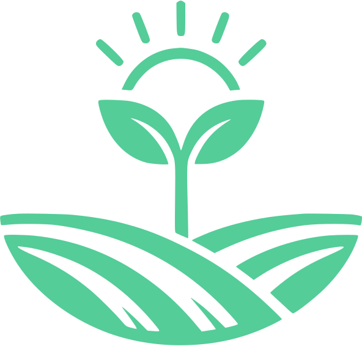
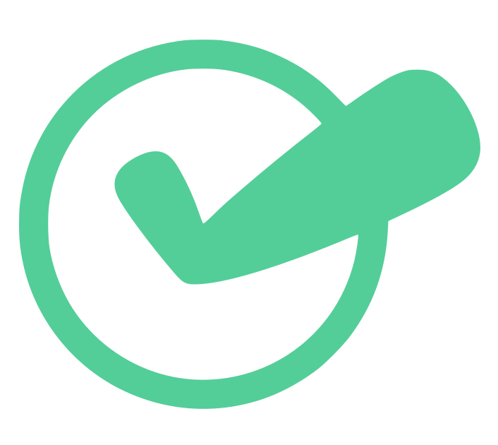
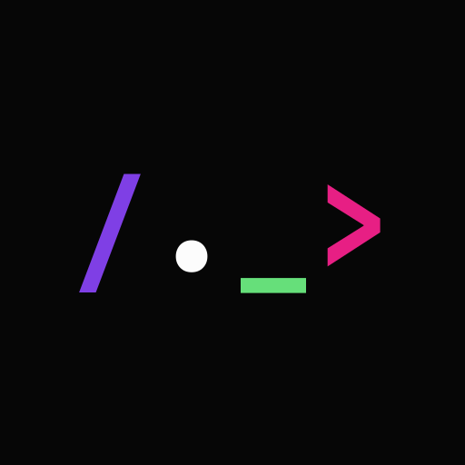

<a href="https://crianex.com">
  <picture>
    <source media="(prefers-color-scheme: dark)" srcset="assets/banner-dark.svg">
    
  </picture>
</a>

 

### Tecnologia para resolver problemas, não para empilhar ferramentas.

 

---

## `/quem somos`

A **Crianex** é um estúdio de produtos digitais. A gente entende o problema antes da primeira linha de código e constrói junto com quem vive esse problema até a solução funcionar.

**entender o problema** → **construir junto** → **corrigir a rota**

## `/nossas crias`

<table>
  <tr>
    <td width="50%" valign="top">
      
      <b><a href="https://no-fluxo.crianex.com">NoFluxo UnB</a></b> 
      Educação · Comunidade · 🟢 no ar
        
      Fluxograma interativo de qualquer curso da UnB, montado a partir do seu histórico, com assistente de IA para planejar até a formatura.
        
      <b>4 mil+</b> estudantes da UnB
    </td>
    <td width="50%" valign="top">
      
      <b><a href="https://site-agro.crianex.com">SiteAgro</a></b> 
      Agronegócio · Gestão · 🟢 no ar
        
      Planejamento estratégico para cooperativas e produtores: da identidade e do diagnóstico ao plano de ação, indicadores e governança.
    </td>
  </tr>
  <tr>
    <td width="50%" valign="top">
      
      <b><a href="https://pontua.crianex.com">Pontua</a></b> 
      Educação · PBL · 🟡 em validação
        
      Avaliações PBL sem planilha: avaliação de pares, autoavaliação e acompanhamento de notas num só lugar.
        
      <b>1 mil+</b> avaliações realizadas
    </td>
    <td width="50%" valign="top">
      
      <b><a href="https://avali.crianex.com">Avalí</a></b> 
      Educação · IA · 🟣 em desenvolvimento
        
      Menos tempo corrigindo, mais tempo ensinando: correção de objetivas e discursivas com IA e relatórios por competência.
        
      <b>20 mil+</b> questões no banco
    </td>
  </tr>
</table>

## `/como a gente constrói`

  
  
  
  
  
  

Começamos pequeno, colocamos na mão de quem usa cedo e deixamos os dados dizerem o próximo passo.

---

  
   
  Tem um problema que merece virar produto? <a href="mailto:contato@crianex.com">contato@crianex.com</a>

